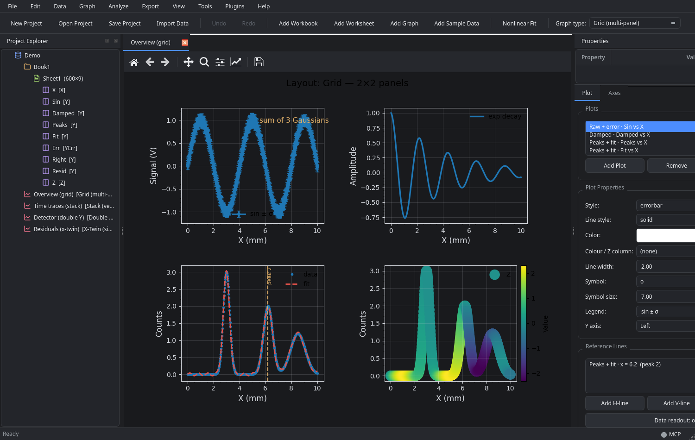
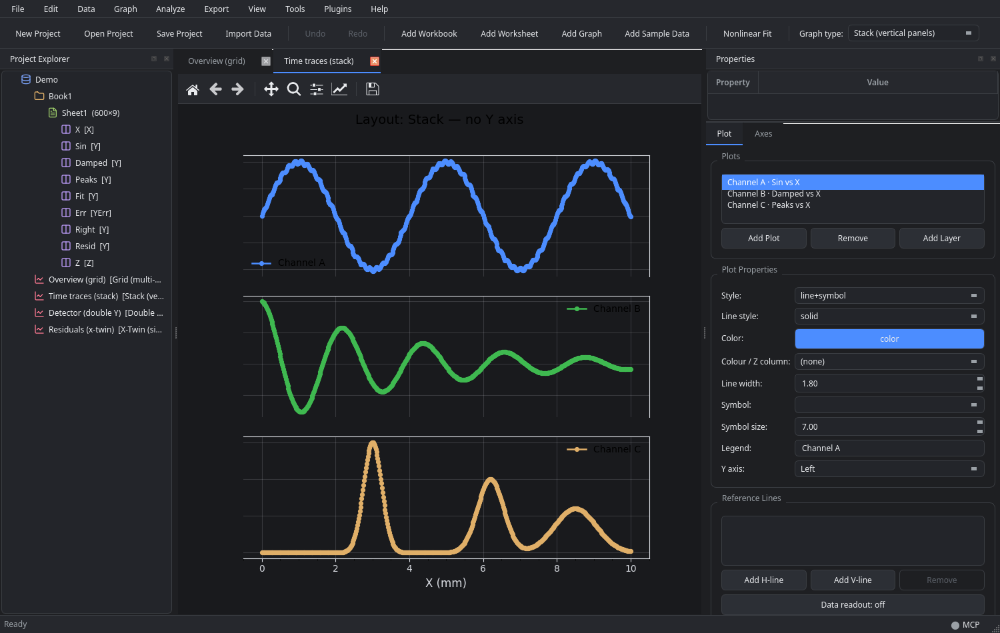
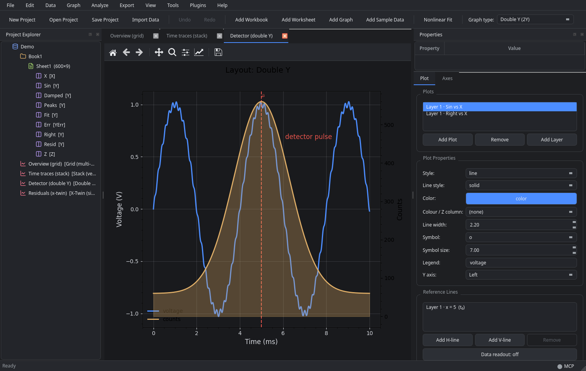
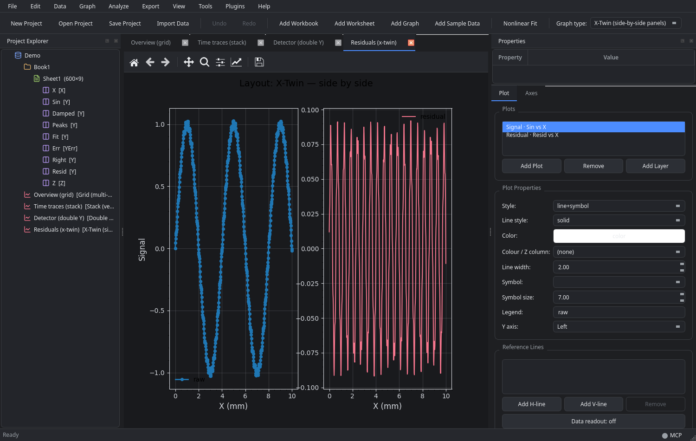

# GraphMatrix


<p>
  
  
  
  
</p>

A cross-platform scientific data analysis and graphing GUI.

GraphMatrix aims to be a Python-first, open alternative to tools like OriginPro:
typed worksheet columns, publication-quality 2D graphs, a real analysis toolkit,
and scriptable automation. It targets Windows, macOS, and Linux from a single codebase.

> Status: **M1–M10 functionally implemented** (M0 skeleton + worksheets, 2D graphs,
> analysis, export, scripting, M7 graph-interaction, M8 provenance/journal output,
> M9 digitizer + command palette, and M10 analysis-depth + colour-mapped/heatmap/
> contour plots + 3D scatter/surface on **PyVista**) plus the M11 start —
> **linked brushing** between worksheets and graphs. See [`PLAN.md`](PLAN.md) §0
> for an honest per-milestone status, and [`ROADMAP.md`](ROADMAP.md) for what
> comes next.
>
> **GraphMatrix is still in active development.** APIs, file formats, and UI details
> may change between releases; please report issues and back up your projects.

## Screenshots

Complex figures rendered by GraphMatrix: layout templates, multi-panel grids,
shared-X stacks with hidden Y axes, dual axes, and side-by-side twins.

<table>
  <tr>
    <td width="50%"><br><sub><b>Grid (2×2)</b> — error bars, a damped oscillation, peaks with a fit and reference line, and a colour-mapped Z panel.</sub></td>
    <td width="50%"><br><sub><b>Stack</b> — three traces share X while the Y axes are hidden for a clean stack.</sub></td>
  </tr>
  <tr>
    <td width="50%"><br><sub><b>Double Y</b> — voltage on the left, detector counts on the right, with an area fill and a reference line.</sub></td>
    <td width="50%"><br><sub><b>X-Twin</b> — signal and residual side by side, sharing Y.</sub></td>
  </tr>
</table>

## Installation

### From source (recommended for now)

```bash
git clone https://github.com/hitaishi2222/GraphMatrix.git
cd GraphMatrix
python -m venv .venv && source .venv/bin/activate
pip install -e ".[dev,mcp]"
graphmatrix
```

### Requirements

- Python 3.10+
- PySide6, NumPy, SciPy, matplotlib, pyqtgraph, lmfit, openpyxl, pyarrow
- Optional: h5py (HDF5), fastmcp (MCP server)

## Quick start

```bash
python -m venv .venv && source .venv/bin/activate
pip install -r requirements-dev.txt

# run the app
PYTHONPATH=src python -m graphmatrix

# run the tests (core only, no GUI required)
pytest
```

Or install as a package:

```bash
pip install -e ".[dev]"
graphmatrix
```

## Layout

```
src/graphmatrix/
  core/        Qt-free engine: model, commands, project I/O, analysis, scripting
  ui/          PySide6 views: main window, panels, graph editor, dialogs, console
  plugins/     Drop-in plugins discovered at startup
tests/         Core + analysis + I/O + export + scripting + headless UI tests
examples/      Sample scripts and projects
packaging/     PyInstaller spec + build script
docs/          Usage and packaging guides
.github/       CI matrix (Windows/macOS/Linux)
```

The golden rule: **`core/` never imports PySide6.** That keeps the engine
testable, headless-batchable, and free to be accelerated later without touching the UI.

## Capabilities

- **Worksheets** — typed columns (X/Y/YErr/Z/label/group/date/text), units, comments,
  masking, formulas, editable grid, undoable copy/paste, row/column operations,
  column drag-reorder, drag-and-drop file import.
- **Import/export** — CSV/TSV, Excel, Parquet, HDF5; export worksheets to CSV.
- **Graphs** — multi-layer 2D; line/scatter/line+symbol/bar/area/step/error-bar;
  dashed/dotted line styles; horizontal & vertical reference lines; hover crosshair
  and nearest-point readout; secondary (dual) Y axis; text annotations; editable axes
  and legend; style templates; drag a column from the tree to plot it; live-linked to data.
- **Graph layout types** — Simple, Stack (vertical panels), Double Y (2Y), X-Twin
  (side-by-side) and Grid (R×C), selectable from **Graph → Graph Type**, the toolbar,
  the project tree's right-click menu, or **Properties**. The sidebar shows only the
  fields that type uses — grid rows/columns and panel gaps for a grid, Y-delta for a
  stack, and so on — and changes are undoable.
- **Analysis** — descriptive stats, linear/polynomial regression, nonlinear fitting
  (Gaussian, Lorentzian, exponential, sinusoid, sigmoid, … via lmfit), peak finding,
  **peak deconvolution** (multi-peak Gaussian/Lorentzian), **slope over an X range**,
  FFT, smoothing, filters, **baseline correction** (polynomial/linear/ALS/rolling-ball/
  rubber-band/median), derivative/integral/interpolation, t-tests, ANOVA, correlation,
  histogram.
- **Recipes** — save an analysis and re-run it on any series, or batch it across many files.
- **Provenance & reproducibility** — GraphMatrix records what you did in plain language
  (**Tools → Analysis Methods…**) and exports an **analysis bundle** (project + data
  CSVs + figures + `reproduce.py` + `methods.md`) that rebuilds every figure.
- **Digitizing** — recover an `(x, y)` curve from a picture of a plot
  (**Analyze → Digitize Curve from Image…**): calibrate with two anchors per axis, then
  extract by darkness or by colour.
- **Journal presets** — one-click Nature/Science/APS/IEEE figure sizes and typography
  (**Graph → Journal Preset**), honoured by the exporter.
- **Command palette** — `Ctrl+Shift+P` fuzzy-searches and runs any action.
- **Publication export** — PDF/SVG/EPS/PNG/TIFF via matplotlib, sized in mm at your DPI,
  dual-axis + annotations, and batch export of every graph in the project.
- **Automation** — embedded Python console, macro recording → runnable script, batch
  import, and a batch analysis pipeline (recipe → per-file report + figure).
- **Appearance** — four theme presets (Classic/Modern × Dark/Light) with matching
  plot-canvas colours, switchable from **View → Theme** and remembered between runs.
- **Preferences** — **View → Preferences…** (`Ctrl+,`) holds the theme, the
  decimals of new columns, the `Ctrl`+wheel zoom, the default export format /
  DPI / size, and whether unsaved changes may be discarded silently.
- **Discoverability** — the toolbar shows an icon and a label for every action
  (and its shortcut in the tooltip), the welcome page lists the shortcuts worth
  knowing, and **F1** opens a searchable list of all of them.

## Command-line interface

GraphMatrix ships a small CLI for scripting and headless use:

```bash
graphmatrix --help
graphmatrix run project.rsproj            # open project(s) in the GUI
graphmatrix list project.rsproj          # list graphs in a project
graphmatrix export project.rsproj -g 1,3-5 --format pdf --out ./out
graphmatrix run pipeline.yaml            # run a headless YAML pipeline
graphmatrix doctor                      # check environment and dependencies
```

- `run` opens one or more project files in the GUI.
- `list` prints the graphs available in a project (1-based indices).
- `export` exports all or selected graphs (`1`, `1,3`, `1-3`, `(1,3)`).
- `doctor` verifies Python, required/optional modules, and the display environment.
- Pipelines are YAML files with steps: `import`, `column`, `graph`, `plot`, `fit`,
  `analyze`, `export`, `save`, and `code`.

## MCP server

GraphMatrix exposes an MCP server for AI assistants. Install the optional extra
first:

```bash
pip install "graphmatrix[mcp]"
```

There are two ways to run it:

- **Client-launched stdio (recommended):** point your client at the `graphmatrix-mcp`
  command. The client starts and stops the server itself; GraphMatrix needs no
  in-app server UI.
- **Port-based server:** run it yourself when several clients should share one
  endpoint.

```bash
graphmatrix-mcp                                   # stdio (clients launch this)
graphmatrix-mcp --transport http --port 8765     # port-based server
```

Client config:

```json
{ "mcpServers": { "graphmatrix": { "command": "graphmatrix-mcp" } } }
```

```json
{ "mcpServers": { "graphmatrix-live": { "url": "http://127.0.0.1:8765/mcp" } } }
```

**The live bridge.** A running GraphMatrix window always listens on a local
Unix socket (`~/.local/state/graphmatrix/ipc-<pid>.sock`). The live tools use it
to edit the open project: the changes appear at once, are undoable with
`Ctrl+Z`, and are visible in the window. No server UI or configuration is
involved — the bridge is part of the application, not of the MCP server.

Tools: `connect`, `summary` (workbooks, sheets, graphs, layout types, and project
versions), `run` (Python against the GraphMatrix API — including pipelines,
versioning, batch statistics, colour/XYZ plots, numeric fit regions via
`api.fit(..., x_min=..., x_max=...)`, and live data tailing via
`graphmatrix.core.live.LiveFileSource`), `export`, and the live tools that
drive the running GUI over its local IPC bridge:

| Live tool | What it does |
| --- | --- |
| `live_summary` | Quick map of the open project (workbooks, sheets, graphs). |
| `live_describe` | Detailed map: every column with its type, which X/Y pairs are plottable, every graph with its panels and series, plus the supported graph types and plot styles. |
| `live_add_data` | Create a worksheet and fill it with columns (literal values or a generator such as `linspace`/`sin`/`random`). |
| `live_create_graph` | Create a graph of any template — `simple`, `stack`, `double-y`, `x-twin`, `grid` — with its first series, and open it as a tab. |
| `live_add_plot` | Add a series to a specific panel (1-based); `y_axis="right"` for the secondary axis, `replace=True` to clear the panel first. |
| `live_set_graph_type` | Switch a graph's template or resize its panel grid. |
| `live_set_property` | Set graph properties (`title`, `panel_gap_x`, `y_delta`, …) or panel properties (`x_label`, `y_label`, `y2_label`, `x_scale`, `show_y_axis`, …). |
| `live_delete_graph` | Remove a graph (undoable in the GUI). |
| `live_save` / `live_export` | Save the project / export graphs to PDF, SVG, PNG, … (same theme and proportions as the preview). |
| `live_run` / `live_open` / `live_screenshot` | Raw Python against the live project, open a project file, capture the window. |

Live edits go through the GUI's own command stack: they appear at once, are
undoable with `Ctrl+Z`, and never touch a file behind your back.

A ready-made skill for assistants lives in
[`.agents/skills/graphmatrix-mcp/SKILL.md`](.agents/skills/graphmatrix-mcp/SKILL.md);
`examples/mcp_live_demo.py` runs the whole workflow against a running window.

## Supported formats

- **Import:** CSV/TSV, Excel (`.xlsx`/`.xls`), Parquet, HDF5/NetCDF (optional)
- **Export:** PDF, SVG, EPS, PNG, TIFF, JPEG (sized in mm at your DPI, and drawn with
  the same theme, grid, title and legend as the on-screen preview)
- **3D plotting** (live scene): optional extra — `pip install pyvista pyvistaqt`

## Keyboard shortcuts

- `Ctrl+N` New project · `Ctrl+O` Open · `Ctrl+S` Save
- `Ctrl+Z` / `Ctrl+Shift+Z` Undo / Redo
- `Ctrl+Shift+P` Command palette · `F1` All keyboard shortcuts
- `Ctrl+W` Close tab · `Ctrl+E` Export the active graph · `Ctrl+,` Preferences
- `Ctrl+=` / `Ctrl+-` / `Ctrl+0` Zoom in / out / fit the active panel
- `F2` Rename selected object / column
- `Ctrl+Alt+N` / `Ctrl+Alt+C` Add row / column at the end of the active sheet
- `Ctrl+Alt+=` Insert rows above the selection
- `Ctrl+Alt+-` / `Ctrl+Alt+Shift+-` Delete selected rows / columns

`Help → Keyboard Shortcuts…` shows the full, searchable list. On macOS the
`Ctrl` keys are the Command key.

## Troubleshooting

- **Hyprland / Wayland:** GraphMatrix sets its app id to `graphmatrix` so it tiles.
  If your compositor still floats it, check window rules matching `python3` or `graphmatrix`.
- **Headless tests:** run with `QT_QPA_PLATFORM=offscreen`.
- **Missing optional deps:** run `graphmatrix doctor`.

## Contributing

Contributions are welcome. Please open an issue or pull request. Keep `core/` free of PySide6
imports so the engine stays testable and headless.

## License

MIT (see `LICENSE` if present).

## Documentation

- [`PLAN.md`](PLAN.md) — architecture, decisions, milestones, current status, risks.
- [`ROADMAP.md`](ROADMAP.md) — forward plan: backlog by area, M7+ sequencing.
- [`docs/USAGE.md`](docs/USAGE.md) — how to use every feature, with scripting examples.
- [`docs/PACKAGING.md`](docs/PACKAGING.md) — building and signing distributable bundles.
